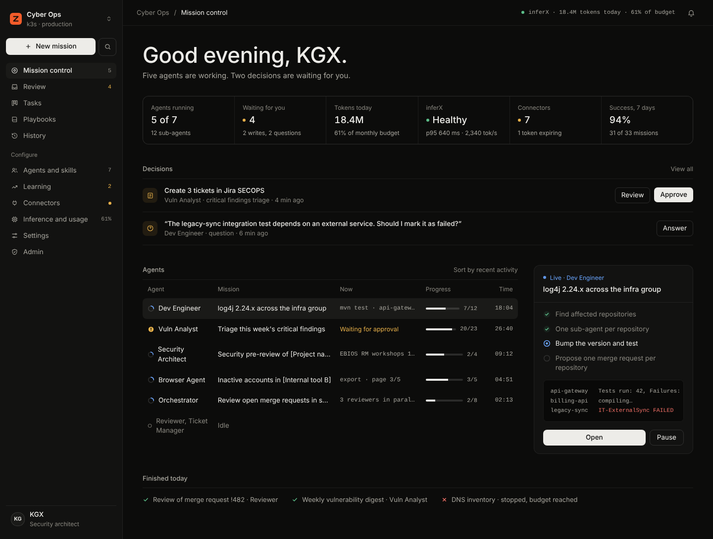
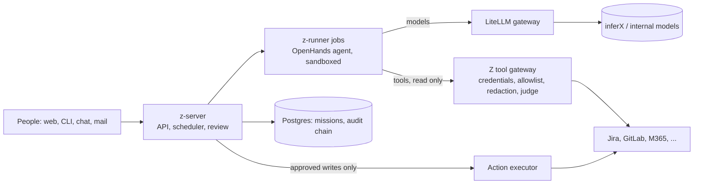

# Z

**Run a team of AI agents on your own infrastructure: they do the work, you approve every write.**

Z is a self-hosted platform for security and engineering teams. You start missions in plain language or from a
playbook ("triage this week's findings", "upgrade this dependency in these 30 repos", "prepare tomorrow's
meetings"), Z runs many agents in parallel against your tools, shows each step live, and nothing changes in Jira,
GitLab, your mailbox or any other tool until a person has approved it. Models run on your own inference cluster;
no prompt, ticket or secret leaves it unless you allow it.



<sub>Design reference of Mission control. More screens in [`design/screenshots/`](design/screenshots/).</sub>

---

## Why Z

| | |
|---|---|
| **Your models, your data** | Agents call models only through your LiteLLM gateway (for example inferX serving GLM and Qwen). External providers are off by default; when enabled, a data-class policy decides per call, and confidential (C2) or restricted (C3) data never leaves the internal cluster. |
| **Humans approve every write** | An agent can only *propose* a ticket, a merge request, a mail or a post. You see a readable preview, edit it or reject it; destructive operations need two approvers and re-authentication. |
| **Agents hold no credentials** | Tools are reached through the Z gateway, which injects the credential, enforces an allowlist of operations and redacts secrets. Read and write credentials are always separate. |
| **Everything is audited** | Every action is in an append-only, hash-chained audit log with signed checkpoints, forwarded to your SIEM over syslog or HTTPS. |
| **Agents get better, under control** | A learning loop turns your edits and rejections into proposals (skills, memory, routing). Each one is evaluated on real cases and applied only by a person, versioned and reversible. |
| **Any tool** | OpenAPI, REST, GraphQL, MCP, read-only SQL, command-line tools and browser flows, plus ready connectors for GitLab, Jira Cloud, Confluence, DefectDojo, Microsoft 365, Google Workspace, Slack, Mattermost and Recorded Future. |

## What you get

- **Web app**: mission control, live timelines, a review inbox for approvals and questions, agents and skills,
  playbooks, connectors and their exposure review, inference and usage, learning, admin and audit, and the
  documentation of the running version (`G D`).
- **CLI `z`**: an interactive session, `z top` (a live dashboard), headless mode for scripts and CI, and every
  admin task.
- **API**: REST and server-sent events, and an MCP server so other agents can start Z missions.
- **Packs** ready to use: `vuln` (finding triage, CVE evidence), `ticketing` (Jira, accounts), `dev` (dependency
  upgrades, merge-request reviews), `archi-isp` (security architecture), `workplace` (mail, calendar, chat on
  Microsoft 365 or Google Workspace), and `core` agents used by all of them.
- **Channels**: start or follow missions from Teams, Slack, Mattermost or e-mail; approval cards link back to Z.
- **Budgets and limits**: per team, user, agent, playbook and mission, checked before every job; every job has a
  token budget, a step limit and a timeout.

## How it works



1. A **mission** is planned into steps; each step runs as a **job** in a hardened, network-isolated container.
2. The agent reads through the **gateway**, which holds the credentials and blocks anything not allowed. A judge
   scans tool results and uploaded files for prompt injection; content from tools is data, never instructions.
3. When the agent wants to change something, it **proposes an action**. A person approves it in Review, and only
   then the **executor** applies it, idempotently.
4. Everything streams live to the web app and the CLI, and lands in the audit log.

The full design is in [`docs/02-architecture.md`](docs/02-architecture.md); the security invariants that no pack,
prompt or setting can weaken are in [`docs/07-security.md`](docs/07-security.md).

## Install

| Target | Guide |
|---|---|
| **k3s** (recommended for a team) | [`docs/15-install-k3s.md`](docs/15-install-k3s.md): step by step, from DNS and secrets to the first mission |
| Kubernetes | [`docs/11-deploy.md`](docs/11-deploy.md) and [`deploy/README.md`](deploy/README.md) (`values-k8s.yaml`) |
| Docker Compose (pilot, laptop) | Quick start below and [`deploy/README.md`](deploy/README.md) |

**Sizing** (no GPU: inference runs on your cluster): a pilot of about 8 parallel jobs needs 8 vCPU, 32 GB RAM and
200 GB SSD; about 32 parallel jobs need 16–24 vCPU, 64–96 GB RAM and 500 GB SSD, or a 3-node k3s.

### Quick start with Docker Compose

```bash
cp .env.example .env && cp config/litellm.example.yaml config/litellm.yaml && cp config/z.example.yaml config/z.yaml
for k in POSTGRES_PASSWORD Z_APP_DB_PASSWORD LITELLM_DB_PASSWORD Z_SOCKET_PROXY_TOKEN; do
  sed -i "s|^$k=.*|$k=$(openssl rand -hex 32)|" .env; done
for k in LITELLM_MASTER_KEY LITELLM_SALT_KEY; do sed -i "s|^$k=.*|$k=sk-$(openssl rand -hex 32)|" .env; done
sed -i "s|^Z_SECRET_KEY=.*|Z_SECRET_KEY=$(openssl rand -base64 48 | tr -d '\n')|" .env
echo "DOCKER_GID=$(stat -c %g /var/run/docker.sock)" >> .env
docker build -f deploy/images/z-server/Dockerfile -t z-server:local .
docker build -f deploy/images/z-runner/Dockerfile -t z-runner:local .
echo "Z_RUNNER_IMAGE=$(docker image inspect --format '{{index .RepoDigests 0}}' z-runner:local)" >> .env
docker compose --env-file .env -f deploy/compose/docker-compose.yml up -d --wait
docker compose --env-file .env -f deploy/compose/docker-compose.yml logs z-server | grep "secret written to"
```

Then open `http://localhost:8080`, sign in with the one-time bootstrap account, configure GitLab sign-in, and set
the inferX key in **Inference → Model providers**. `Z_RUNNER_IMAGE` must be pinned by digest in production; on a
laptop without a registry, `Z_ENV=development` relaxes that check ([`deploy/README.md`](deploy/README.md)).

### CLI

```bash
uv tool install ./cli --with ./packages/z-common
z login && z
```

## Secrets and accounts

- **Platform secrets** (database, encryption keys, GitLab OIDC client secret, inferX key) live in your secret
  manager or a Kubernetes Secret; the chart generates and keeps the internal ones. The inferX key can also be set
  and rotated from the web app.
- **Tool credentials**: one read and one write service account per tool (for example `svc-z-read` and
  `svc-z-write`), referenced from the connector (`env:`, `file:`, `vault:` or `kubernetes:`), or typed once in the
  connector page, where they are sealed and never shown again. Microsoft 365 and Google use each person's own
  delegated grant instead of a shared account.
- Every name is listed in [`.env.example`](.env.example) and explained in [`docs/15-install-k3s.md`](docs/15-install-k3s.md).

## Documentation

| | |
|---|---|
| Product and architecture | [`01-product`](docs/01-product.md), [`02-architecture`](docs/02-architecture.md), [`03-domain-and-contracts`](docs/03-domain-and-contracts.md) |
| Runtime, connectors, models | [`04-runtime`](docs/04-runtime.md), [`05-connectors`](docs/05-connectors.md), [`06-inference-and-usage`](docs/06-inference-and-usage.md) |
| Security, learning | [`07-security`](docs/07-security.md), [`08-learning-and-evals`](docs/08-learning-and-evals.md), [`12-identity-access-and-admin`](docs/12-identity-access-and-admin.md) |
| Interfaces | [`09-web-ui`](docs/09-web-ui.md), [`10-cli`](docs/10-cli.md) |
| Operations | [`11-deploy`](docs/11-deploy.md), [`13-ci-cd`](docs/13-ci-cd.md), [`14-release-and-changes`](docs/14-release-and-changes.md), [`15-install-k3s`](docs/15-install-k3s.md) |
| Decisions and status | [`docs/adr/`](docs/adr/), [`ROADMAP`](docs/ROADMAP.md), [`ACCEPTANCE`](docs/ACCEPTANCE.md) |

## Status

Version 1 is feature complete and tested: unit, integration (real Postgres, real Docker), UI, and end-to-end tests
on the Compose stack and on a kind cluster run in CI on every change, with security scanners, signed images and
SBOMs. What has not been proven yet is listed honestly in [`docs/ACCEPTANCE.md`](docs/ACCEPTANCE.md): mainly runs
against your real inferX, GitLab, Jira and Microsoft 365, which happen on your staging install.

## Repository

| Path | What it holds |
|---|---|
| `server/`, `runner/`, `cli/`, `browser/`, `packages/z-common/` | z-server, z-runner, the `z` CLI, the browser worker, shared models |
| `ui/` | The web app (React) |
| `contracts/` | OpenAPI and JSON Schemas: the source of truth between components |
| `packs/` | Agents, skills, playbooks, connectors, objectives and evals |
| `deploy/` | Compose stack, Helm chart, images, per-environment values |
| `config/` | Example platform and model-gateway configuration |
| `docs/`, `design/` | Specification, guides, decisions; mockups and design tokens |
| `tests/`, `ci/`, `security/` | Fakes and e2e tests, CI scripts, scanner policies |

Contributing: read [`CLAUDE.md`](CLAUDE.md) (also for human contributors: it lists the invariants and checks) and
[`docs/14-release-and-changes.md`](docs/14-release-and-changes.md). Keep this repository private if it carries
anything about your organisation: environment-specific values live only in git-ignored files.
